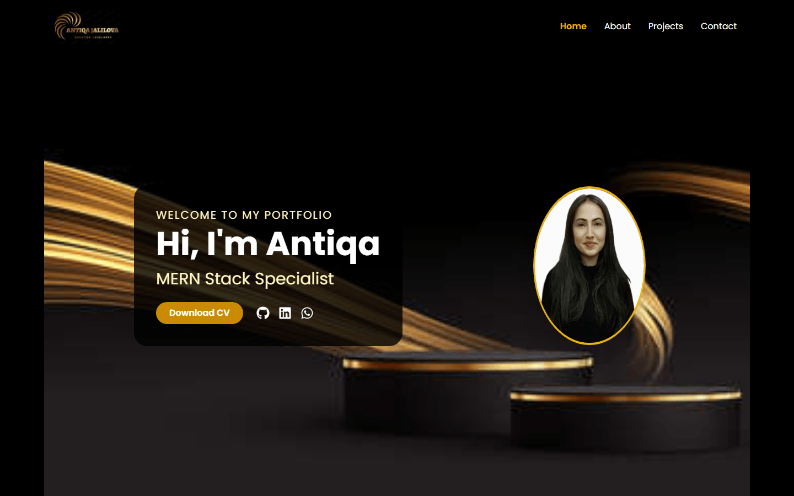

# Antiqa Jalilova – 3D Portfolio (v1)

[](https://my-portfolio-eta-mocha-32.vercel.app)

> **Newer portfolio:** this is my first portfolio. My current one is at **[antiqa-portfolio.vercel.app](https://antiqa-portfolio.vercel.app)**.

**AZ:** Bu, React, Tailwind CSS və Three.js ilə qurduğum ilk portfolio saytımdır; yeni portfoliom [antiqa-portfolio.vercel.app](https://antiqa-portfolio.vercel.app) ünvanındadır.

A personal portfolio with interactive 3D models, my skills and courses, my projects (with live demos and source code) and a contact form.



## Features

- **Home**: intro, rotating role titles, CV download, GitHub / LinkedIn / WhatsApp links.
- **About**: skills grid, courses tab and an interactive 3D model (drag to rotate).
- **Projects**: 7 projects, each with a live demo link and GitHub link (frontend and backend where there is one).
- **Contact**: validated form that opens the visitor's email app with a pre-filled message (`mailto:`), so it works without a server. An optional API mode is described below.
- **Fast 3D**: `.glb` models compressed from 9.4 MB to 1.2 MB (meshopt + WebP textures). three.js is code-split and loaded only when a model scrolls into view. Phones, data-saver and reduced-motion users get a light WebP poster with a "View in 3D" button.
- **SEO**: per-page titles, description, canonical, Open Graph / Twitter cards, JSON-LD, `robots.txt`, `sitemap.xml`, favicon.
- **Responsive**: checked at 390, 768, 1440 and 1920 px with no horizontal scroll and a working mobile menu.

## Tech stack

React 18, React Router 6, Vite 4, Tailwind CSS 3, Three.js with @react-three/fiber and @react-three/drei, react-icons. Hosted on Vercel.

## Run locally

```bash
git clone https://github.com/codelady-ship/my-portfolio.git
cd my-portfolio
npm install
npm run dev        # http://localhost:5173
npm run build      # production build in dist/
npm run preview    # serve the build locally
```

### Optional: contact API (`VITE_API_URL`)

By default the contact form uses `mailto:jalilova.antiqa@gmail.com` and needs no backend.
To send messages to a server instead, copy `.env.example` to `.env` and set:

```bash
VITE_API_URL=https://your-api.example.com
```

The form then sends `POST ${VITE_API_URL}/api/contact` with JSON `{ name, email, phone, message }` and expects a 2xx response.
Use an HTTPS URL in production: an `http://` API is blocked as mixed content on the HTTPS site.
On Vercel, add `VITE_API_URL` under *Project → Settings → Environment Variables* and redeploy.
A matching Express backend is in [backend-for-my-portfolio](https://github.com/codelady-ship/backend-for-my-portfolio).

### Re-compressing 3D models

```bash
npx @gltf-transform/cli optimize input.glb public/models/output.glb \
  --compress meshopt --texture-compress webp --texture-size 1024 --simplify false
```

drei's `useGLTF` includes the meshopt decoder, so no extra decoder files are needed.

## Deployment

Vercel builds the `master` branch automatically (`npm run build`, output `dist/`).
`vercel.json` rewrites page routes (`/about`, `/projects`, `/contact`) to `index.html`, so reloading or sharing a page link works.

## What I learned

- Building a single-page app with React Router and making deep links work on static hosting.
- Loading and animating glTF models with React Three Fiber, then making them light with compression, lazy loading and a poster fallback for phones.
- Styling responsive layouts with Tailwind CSS.
- Handling a contact form without a server, and keeping the backend optional through environment variables.
- Basic SEO for a single-page app: meta tags, Open Graph, sitemap and robots.txt.
